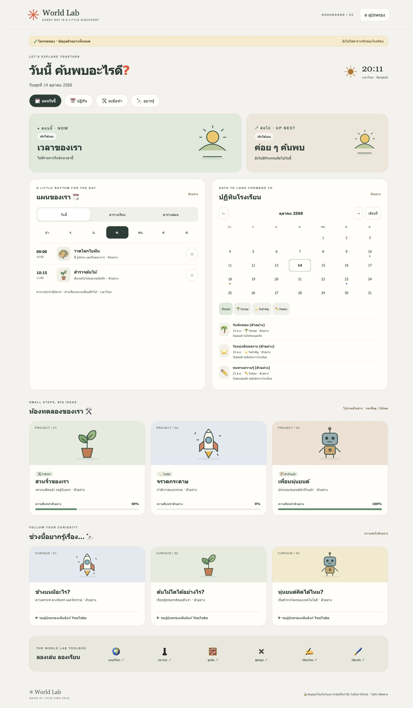

# World Lab Dashboard v2

A Thai, picture-first learning dashboard with original SVG illustrations, small labels, and a calm World Lab palette. This is a **new, separate project**. The existing `worldlab-club/dashboard` website is unchanged.

## Run locally

Requires Python 3; Node.js 18+ is only needed for tests. There are no npm dependencies and no build step.

```sh
cd dashboard-v2
npm start
# Open http://127.0.0.1:4173
```

Or run `python3 -m http.server 4173 --bind 127.0.0.1`. Serve over HTTP: opening `index.html` as a `file://` URL will not load JavaScript modules reliably.

```sh
npm test
npm run check
```

## Ready in the MVP

- Large illustrated current / next activity cards, with Asia/Bangkok time and honest empty states outside lesson hours.
- Weekly recurring timetable with day selection and daily / class / teaching filters. Completion ticks are stored separately per calendar date and retained for up to 31 days.
- Month calendar, previous / next / current month, date selection, holidays / important dates / exams filters, and text labels alongside colored markers.
- Illustrated hobby projects with details, latest update text, progress percentage, and idea / doing / done status controls.
- Interests cards with optional HTTPS educational links. **YouTube links start unconfigured**; a parent should choose and verify official age-appropriate sources. There are no invented video IDs, autoplay players, embeds, APIs, or API keys.
- Links to existing World Lab learning apps. They open only when selected.
- Parent corner: add, edit, and explicitly confirm deletion in each category; choose picture, schedule day/type/time, event date/type, project status/progress/update, interest link, and example/personal label.
- Responsive mobile, tablet and desktop layout, Thai labels, keyboard-operable native controls, modal dialogs with names and Escape dismissal, focus rings, skip link, reduced-motion support, and labeled progress indicators.

## Data profiles and privacy

The parent explicitly approved making this educational dashboard public on 2026-10-14 after the audience and GitHub Pages limitations were explained. The default app uses only confirmed information: the school term date range and existing World Lab learning resources. See [data provenance](docs/PROVENANCE.md). Lesson/teaching times, individual course-track enrollment, holidays, exams, hobby statuses and current interests remain unconfirmed; they are not invented. Unknown schedules show “awaiting confirmation”.

`data-profile.js` selects `dashboard-data.js`, the approved public educational baseline. Anyone can read these published files. No child photos, detailed daily timetable, family identifiers, account emails, credentials or unrelated records are included. Only add information appropriate for the approved public audience. A future family-only section requires real authentication and separate protected storage.

Browser editing uses a profile-specific localStorage key. Local edits stay on that browser/origin and do not sync to GitHub, the public site, or other devices. Prior prototype/sample storage is not automatically migrated. Anyone using the same browser profile can see/change local records; clearing browser data can lose them. The parent corner is an editor, not an authenticated private area. Storage failures display a warning. There is no cloud backup or cross-device sync.

An optional sample-only export remains available:

```sh
npm run build:demo
# Produces dist-demo/ with invented, clearly labelled examples only.
```

The exporter copies six allowlisted application files plus the exact verified logo/font asset allowlist, replaces the data entry point with generic samples, excludes the confirmed-data module/docs/screenshots, removes stale unapproved output, and audits known real-data markers. Sample and confirmed profiles use different browser storage keys. Demo schedules and exam dates are labelled invented examples; no worksheet handwriting was used as an actual schedule. YouTube links remain unconfigured until verified choices are supplied.

No external fonts, images, analytics, weather or scripts load automatically; CSP blocks connections. External learning links leave the site only when clicked and have their own privacy policies. GitHub hosting can collect standard request/security logs.

## Repository and hosting

- Repository: [worldlab-club/dashboard-v2](https://github.com/worldlab-club/dashboard-v2), public by explicit parent authorization.
- Branch: `main`.
- GitHub Pages: [https://worldlab-club.github.io/dashboard-v2/](https://worldlab-club.github.io/dashboard-v2/).
- Publishing source: `main` / repository root; `.nojekyll` serves the buildless modules unchanged.
- World Lab Git transport: existing `git@github-worldlab:worldlab-club/dashboard-v2.git`, verified to authenticate as `worldlab-club`.
- The original `worldlab-club/dashboard` is unchanged. No paid plan, new credential or unrelated permission was added.

## Design references and structure

Inspected [original dashboard](https://worldlab-club.github.io/dashboard/) and its [index.html source](https://github.com/worldlab-club/dashboard/blob/main/index.html) at public commit `aa20ff7087ada3256e4a47684e5a147e5c353f8e`. The old repo contains one HTML file and no README or AGENTS.md. This project retains the warm background and World Lab green/yellow/orange/blue palette, buildless HTML approach, and widget focus. It now uses the user-supplied Canva logo and exact lab palette, the original dashboard's digital typography (self-hosted Sanchez, DM Sans and Noto Sans Thai), and original SVG widget illustrations. See [the synthesized CI guide](docs/BRAND_GUIDE.md) and [asset sources/licenses](assets/SOURCES.md). No old weather/navigation scripts or runtime external fonts are loaded.

- `index.html` — semantic page and modal shells, CSP
- `styles.css` — palette, illustrated card layouts, responsive breakpoints
- `art.js` — original inline SVG picture vocabulary
- `model.js` — samples, timezone logic, filters, validation
- `app.js` — UI, local persistence, editor, status updates
- `dashboard-data.js` — parent-approved public educational baseline and provenance
- `data-profile.js` — confirmed-data entry point, replaced in sample export
- `scripts/build-demo.mjs` — sample-only allowlist exporter
- `tests/` — model, private baseline and demo-isolation checks
- `docs/QA.md` — verification evidence and limitations


